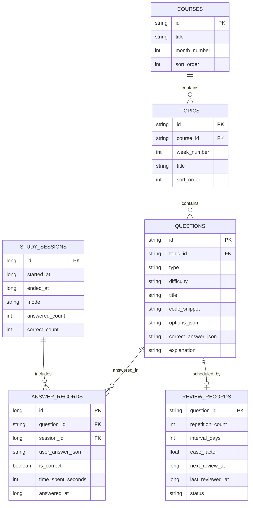

# Agent Learning：Android 离线学习 App 开发文档

> **版本：** V1.0（MVP）  
> **目标用户：** 单一用户，当前仅在自己的一部 Android 手机上使用  
> **核心课程：** LangChain + LangGraph + LangSmith，16 周学习计划  
> **存储策略：** Room + SQLite 本地存储  
> **网络要求：** 核心功能完全离线  
> **题库策略：** 固定 JSON 题库，不接入 AI 实时出题

---

## 1. 项目概述

### 1.1 项目目标

开发一款 Android 原生学习 App，帮助用户利用通勤、午休、排队等碎片化时间，复习 LangChain、LangGraph 和 LangSmith 的核心知识，并通过代码阅读、代码补全、Debug 等题型强化工程实践能力。

App 与电脑上的系统学习和项目实战互补：

- **电脑：** 阅读官方文档、编写代码、完成项目。
- **手机：** 知识点回忆、选择题、代码理解、错题复习和学习进度追踪。

### 1.2 第一版范围

第一版聚焦于一个人、一部手机、本地固定题库。

**包含：**

- 16 周课程目录。
- 按周、知识点浏览题目。
- 单选题、多选题、代码阅读题、代码补全题、找 Bug 题。
- 即时判题和答案解析。
- 答题历史和错题本。
- 基础间隔复习。
- 学习进度和正确率统计。
- JSON 题库初始化导入。
- 本地数据导出和恢复。
- 无网络使用。

**暂不包含：**

- 用户注册、登录和多用户管理。
- 云端数据库和多设备同步。
- FastAPI 后端。
- Supabase。
- LangChain / LangGraph 在线运行服务。
- LLM API 和 AI 实时出题。
- 手机端 Python 代码执行沙箱。
- 社交、排行榜和付费功能。

### 1.3 MVP 验收目标

用户安装 App 后，可以在没有网络的情况下：

1. 浏览 16 周课程和知识点。
2. 完成各类题目并查看解析。
3. 自动保存答题历史。
4. 查看和重做错题。
5. 根据复习计划完成每日复习。
6. 查看课程掌握情况。
7. 备份和恢复学习数据。

---

## 2. 技术选型

| 模块 | 技术 | 用途 |
|---|---|---|
| 开发语言 | Kotlin | Android 原生开发 |
| UI | Jetpack Compose | 声明式 UI |
| 架构 | MVVM + Repository | 分离 UI、业务与数据 |
| 本地数据库 | Room + SQLite | 课程、题库、答题记录 |
| 本地设置 | DataStore | 学习目标、偏好设置 |
| 异步处理 | Kotlin Coroutines + Flow | 异步数据和状态流 |
| 依赖注入 | Hilt | 依赖管理 |
| 导航 | Navigation Compose | 页面跳转 |
| JSON 解析 | kotlinx.serialization 或 Moshi | 读取题库文件 |
| 图表 | Compose 图表库或自绘 | 学习统计 |
| 测试 | JUnit、Turbine、Compose UI Test | 单元和 UI 测试 |

### 为什么选择 Kotlin + Jetpack Compose？

- Android 原生体验好。
- Room、DataStore、通知和系统备份能力集成方便。
- Compose 适合快速构建现代化学习界面。
- 不需要额外引入跨平台框架。
- 可以作为一个完整的 Android 工程项目积累经验。

---

## 3. 整体架构

采用分层架构，避免将业务逻辑直接写在 Compose 页面或 Activity 中。

```text
┌──────────────────────────────────────────┐
│             Presentation Layer           │
│  Jetpack Compose / Navigation Compose    │
│  Home / Curriculum / Quiz / Review       │
│  Statistics / Settings                   │
└────────────────────┬─────────────────────┘
                     │ UI State / Events
┌────────────────────▼─────────────────────┐
│               ViewModel Layer            │
│  Screen State / User Actions / Flow      │
└────────────────────┬─────────────────────┘
                     │
┌────────────────────▼─────────────────────┐
│                Domain Layer               │
│  QuizEngine                               │
│  ReviewScheduler                          │
│  ProgressCalculator                       │
│  Use Cases                                │
└────────────────────┬─────────────────────┘
                     │
┌────────────────────▼─────────────────────┐
│                 Data Layer                │
│  Repository / Room DAO / DataStore        │
│  Question JSON Importer                   │
└──────────────┬─────────────────┬─────────┘
               │                 │
       ┌───────▼───────┐  ┌──────▼─────────┐
       │ Room / SQLite│  │ JSON Assets    │
       │ User Data    │  │ Initial Bank   │
       └──────────────┘  └────────────────┘
```

### 分层职责

**Presentation**
- Compose 页面、组件和导航。
- 展示 ViewModel 提供的 UI State。
- 将用户操作发送给 ViewModel。

**ViewModel**
- 管理页面状态。
- 调用 Use Case。
- 通过 StateFlow 向 UI 暴露状态。
- 不直接编写 SQL 或处理 JSON 文件细节。

**Domain**
- 判题规则。
- 复习时间计算。
- 学习进度计算。
- 不依赖 Android UI 和 Room。

**Data**
- Room Entity、DAO、Database。
- Repository 实现。
- JSON 题库导入。
- DataStore 设置读写。

### 架构原则

- UI 不直接访问 DAO。
- ViewModel 不直接处理 SQL。
- 业务规则放在 Domain 层。
- Repository 隔离数据来源。
- 题库内容与用户答题历史分开存储。
- 所有数据库操作在后台协程执行。

---

## 4. 功能模块与页面

第一版采用底部导航，建议包含：首页、课程、复习、统计、设置。

### 4.1 首页 Dashboard

展示：

- 今日学习任务和完成数量。
- 今日待复习题目数量。
- 当前学习周次。
- 累计正确率。
- 连续学习天数。
- 快速开始新练习。
- 快速开始今日复习。

首页数据应由数据库中的答题记录和复习记录计算，不要硬编码统计数字。

### 4.2 课程 Curriculum

课程按 4 个月、16 周组织。

```text
Month 1 - LangChain
  Week 01: LLM Fundamentals
  Week 02: Prompt & Structured Output
  Week 03: Tools & Agents
  Week 04: RAG

Month 2 - LangGraph
  Week 05: State & Nodes
  Week 06: Edges & Routing
  Week 07: Persistence & Memory
  Week 08: Human-in-the-loop

Month 3 - Agent Engineering
  Week 09: Multi-Agent
  Week 10: Agentic RAG
  Week 11: LangSmith Tracing
  Week 12: Evaluation

Month 4 - Production
  Week 13: Production Architecture
  Week 14: Testing & Security
  Week 15: Deployment & Monitoring
  Week 16: Final Project
```

每周包含多个 Topic，每个 Topic 关联题目。

例如：

```text
Week 05 - LangGraph
  Topic 1: What is State?
  Topic 2: TypedDict
  Topic 3: State Updates
  Topic 4: Reducers
  Topic 5: MessagesState
```

课程状态可以分为：
- NOT_STARTED
- IN_PROGRESS
- COMPLETED

完成状态应由实际学习记录和课程完成规则计算。

### 4.3 练习 Quiz

第一版支持以下题型：

| 题型 | 说明 | 实现方式 |
|---|---|---|
| SINGLE_CHOICE | 单选 | 选择一个选项 |
| MULTIPLE_CHOICE | 多选 | 选择多个选项 |
| CODE_READING | 代码阅读 | 阅读代码后选择执行结果或行为 |
| CODE_COMPLETION | 代码补全 | 对缺失代码片段进行选择 |
| DEBUGGING | 找 Bug | 识别错误位置或错误原因 |

答题流程：

1. 根据课程、Topic 或练习模式加载题目。
2. 展示题目和选项/代码。
3. 用户提交答案。
4. 判题引擎计算结果。
5. 显示正确答案和解释。
6. 保存 AnswerRecord。
7. 更新 ReviewRecord。
8. 进入下一题或结束练习。

代码展示要求：
- 使用等宽字体。
- 保留缩进和换行。
- 支持长代码水平或垂直滚动。
- 支持复制代码。
- 适当增加语法高亮。

**第一版不实现手机端 Python 代码执行环境。** 通过代码阅读、补全、找 Bug 和解释训练即可。

### 4.4 错题与复习 Review

支持以下筛选：
- 今日待复习。
- 最近答错。
- 多次答错。
- 已掌握。
- 按课程和知识点筛选。

每次复习也应写入答题历史。不要只覆盖题目的最后一次答案。

### 4.5 统计 Statistics

建议展示：
- 每日完成题数。
- 每周答题正确率。
- 各课程模块掌握度。
- 错题数量变化。
- 连续学习天数。
- 课程完成比例。

统计口径要明确：
- 正确率 = 正确答题次数 / 总答题次数。
- 题目掌握状态不能仅由一次答对决定。
- 模块掌握度应结合近期答题表现和复习情况。

### 4.6 设置 Settings

第一版建议包括：
- 每日学习目标。
- 每日复习提醒开关和时间。
- 题库版本信息。
- 导出学习数据。
- 从备份恢复。
- 重置本地数据（需二次确认）。

---

## 5. Room 数据库设计

建议先设计 6 张核心表：

| 表名 | 作用 |
|---|---|
| courses | 课程和月份信息 |
| topics | 每周知识点 |
| questions | 固定题库 |
| answer_records | 每次答题历史 |
| review_records | 每道题的复习状态 |
| study_sessions | 每次学习会话 |

### 5.1 ER 关系



### 5.2 QuestionEntity

```kotlin
@Entity(
    tableName = "questions",
    indices = [Index("topicId")]
)
data class QuestionEntity(
    @PrimaryKey
    val id: String,

    val topicId: String,
    val type: String,
    val difficulty: String,
    val title: String,

    val codeSnippet: String? = null,

    // JSON 序列化的选项列表
    val optionsJson: String? = null,

    // JSON 序列化的正确答案
    val correctAnswerJson: String,

    val explanation: String,
    val tagsJson: String? = null,

    // 题目内容版本，便于题库更新
    val contentVersion: Int = 1
)
```

### 5.3 AnswerRecordEntity

```kotlin
@Entity(
    tableName = "answer_records",
    indices = [
        Index("questionId"),
        Index("answeredAt"),
        Index("sessionId")
    ],
    foreignKeys = [
        ForeignKey(
            entity = QuestionEntity::class,
            parentColumns = ["id"],
            childColumns = ["questionId"],
            onDelete = ForeignKey.RESTRICT
        )
    ]
)
data class AnswerRecordEntity(
    @PrimaryKey(autoGenerate = true)
    val id: Long = 0,

    val questionId: String,
    val sessionId: Long? = null,

    val userAnswerJson: String,
    val isCorrect: Boolean,

    val timeSpentSeconds: Int,
    val answeredAt: Long
)
```

### 5.4 ReviewRecordEntity

```kotlin
@Entity(
    tableName = "review_records",
    foreignKeys = [
        ForeignKey(
            entity = QuestionEntity::class,
            parentColumns = ["id"],
            childColumns = ["questionId"],
            onDelete = ForeignKey.CASCADE
        )
    ]
)
data class ReviewRecordEntity(
    @PrimaryKey
    val questionId: String,

    val repetitionCount: Int = 0,
    val intervalDays: Int = 0,
    val easeFactor: Float = 2.5f,

    val nextReviewAt: Long,
    val lastReviewedAt: Long? = null,

    val status: String = "NEW"
)
```

### 5.5 其他 Entity

`CourseEntity`：

```kotlin
@Entity(tableName = "courses")
data class CourseEntity(
    @PrimaryKey val id: String,
    val title: String,
    val monthNumber: Int,
    val sortOrder: Int
)
```

`TopicEntity`：

```kotlin
@Entity(
    tableName = "topics",
    indices = [Index("courseId")]
)
data class TopicEntity(
    @PrimaryKey val id: String,
    val courseId: String,
    val weekNumber: Int,
    val title: String,
    val description: String?,
    val sortOrder: Int
)
```

`StudySessionEntity`：

```kotlin
@Entity(tableName = "study_sessions")
data class StudySessionEntity(
    @PrimaryKey(autoGenerate = true)
    val id: Long = 0,

    val startedAt: Long,
    val endedAt: Long? = null,

    val mode: String,
    val answeredCount: Int = 0,
    val correctCount: Int = 0
)
```

> 实际开发时，Room Entity 中的外键、索引和表名必须与 DAO 查询保持一致。新增字段时要增加数据库迁移，不要在正式使用后随意使用 destructive migration。

### 5.6 DAO 示例

```kotlin
@Dao
interface QuestionDao {

    @Query("""
        SELECT * FROM questions
        WHERE topicId = :topicId
        ORDER BY id
    """)
    fun observeByTopic(topicId: String): Flow<List<QuestionEntity>>

    @Query("""
        SELECT * FROM questions
        WHERE id = :questionId
        LIMIT 1
    """)
    suspend fun getById(questionId: String): QuestionEntity?

    @Insert(onConflict = OnConflictStrategy.REPLACE)
    suspend fun insertAll(items: List<QuestionEntity>)

    @Query("SELECT COUNT(*) FROM questions")
    suspend fun count(): Int
}
```

Repository 示例：

```kotlin
interface QuestionRepository {
    fun observeQuestions(topicId: String): Flow<List<Question>>
    suspend fun getQuestion(id: String): Question?
}
```

Repository 实现负责把 Entity 转换为 Domain Model。

---

## 6. JSON 固定题库设计

### 6.1 文件目录

```text
app/src/main/assets/questions/
├── manifest.json
├── week01.json
├── week02.json
├── week03.json
├── week04.json
├── week05.json
├── ...
└── week16.json
```

建议按周拆分，方便后续更新单周题库。

### 6.2 示例题库

`week05.json`：

```json
{
  "schemaVersion": 1,
  "week": 5,
  "module": "LangGraph",
  "topics": [
    {
      "id": "lg_state_001",
      "name": "State Management",
      "description": "Understand graph state and updates."
    }
  ],
  "questions": [
    {
      "id": "lg_state_q001",
      "topicId": "lg_state_001",
      "type": "SINGLE_CHOICE",
      "difficulty": "BEGINNER",
      "title": "What is the purpose of State in LangGraph?",
      "codeSnippet": null,
      "options": [
        {"id": "A", "text": "Define all tools"},
        {"id": "B", "text": "Maintain shared graph data"},
        {"id": "C", "text": "Store API keys"},
        {"id": "D", "text": "Connect to vector databases"}
      ],
      "correctAnswer": ["B"],
      "explanation": "State stores data shared across graph nodes.",
      "tags": ["State", "Fundamentals"]
    }
  ]
}
```

### 6.3 题目 JSON 规范

每道题至少需要：
- 唯一且稳定的 `id`。
- `topicId`。
- `type`。
- `difficulty`。
- `title`。
- `options`（适用时）。
- `correctAnswer`。
- `explanation`。
- `tags`。
- 适用的技术版本或文档基准。

建议补充字段：

```json
{
  "technology": "LangGraph",
  "apiVersion": "v1",
  "documentationBaseline": "official-stable-docs",
  "sourceUrl": "https://docs.langchain.com/oss/python/langgraph/overview"
}
```

链接和版本信息应在题库维护时核实，不要假设所有题目都适用于所有版本。

### 6.4 第一次启动导入流程

```text
App Launch
   |
   v
Check Database
   |
   +-- Courses/Questions already exist --> Open Home
   |
   +-- Empty database
          |
          v
     Read manifest.json
          |
          v
     Parse weekly JSON files
          |
          v
     Validate IDs and references
          |
          v
     Insert courses/topics/questions
          |
          v
       Open Home
```

导入必须放在 Room transaction 中，避免导入一半失败后留下不完整题库。

伪代码：

```kotlin
suspend fun importInitialQuestionBank() {
    database.withTransaction {
        if (questionDao.count() > 0) return@withTransaction

        val bank = questionAssetReader.loadAll()
        bankValidator.validate(bank)

        courseDao.insertAll(bank.courses)
        topicDao.insertAll(bank.topics)
        questionDao.insertAll(bank.questions)
    }
}
```

### 6.5 题库更新策略

题库内容与用户数据分开处理。

建议：
- 使用稳定的题目 ID。
- 每份题库带 `schemaVersion` 和 `contentVersion`。
- 题库更新只更新课程、Topic 和 Question。
- 不覆盖 `answer_records` 和 `review_records`。
- 对已经删除但存在答题历史的题目，优先采用停用标记，而不是直接删除。
- 数据库结构变化使用 Room Migration。

---

## 7. 答题与复习业务逻辑

### 7.1 判题规则

**单选题：**
- 用户答案与正确答案 ID 相同则正确。

**多选题：**
- 比较两个答案集合。
- 第一版采用完全匹配，不采用部分得分。
- 比较前排序或转换为 Set，避免选项顺序影响结果。

**代码阅读、代码补全、Debug：**
- 第一版使用固定选项。
- 复用单选或多选判题逻辑。
- 代码片段仅用于展示，不在手机上执行。

### 7.2 答题事务

提交答案时建议在一个数据库事务中完成：

1. 插入 AnswerRecord。
2. 查询或创建 ReviewRecord。
3. 更新复习状态和下次复习时间。
4. 更新当前 StudySession 的统计。

这样可以避免答题历史已保存，但复习状态没有更新的情况。

### 7.3 基础间隔复习策略

第一版采用简单、可解释的间隔策略：

| 复习表现 | 下一次复习建议 |
|---|---|
| 首次答对 | 1 天后 |
| 连续第二次答对 | 3 天后 |
| 连续第三次答对 | 7 天后 |
| 后续答对 | 14 天、30 天 |
| 答错 | 1 天后重新复习 |

可根据连续答对次数计算间隔：

```kotlin
fun nextIntervalDays(
    isCorrect: Boolean,
    repetitionCount: Int
): Int {
    if (!isCorrect) return 1

    return when (repetitionCount) {
        0 -> 1
        1 -> 3
        2 -> 7
        3 -> 14
        else -> 30
    }
}
```

注意：上面的函数是 MVP 简化示例。实际更新时要在保存前正确处理当前 repetitionCount 的定义，并为新题、答错和已掌握状态分别编写单元测试。

更进一步可以引入 SM-2 算法，但不建议在第一版过早增加复杂度。

### 7.4 每日任务生成

每日任务由两部分组成：
- 到期复习题目。
- 当前课程的新题。

建议默认优先复习到期题目，再安排新题。每日题量由用户设置，例如 10、15 或 20 题。

---

## 8. 项目目录结构

建议使用 Feature-based 目录结构：

```text
AgentLearning/
├── app/
│   └── src/main/
│       ├── assets/
│       │   └── questions/
│       ├── java/com/agentlearning/
│       │   ├── data/
│       │   │   ├── local/
│       │   │   │   ├── AppDatabase.kt
│       │   │   │   ├── dao/
│       │   │   │   └── entity/
│       │   │   ├── repository/
│       │   │   └── importer/
│       │   ├── domain/
│       │   │   ├── model/
│       │   │   ├── repository/
│       │   │   └── usecase/
│       │   ├── feature/
│       │   │   ├── home/
│       │   │   ├── curriculum/
│       │   │   ├── quiz/
│       │   │   ├── review/
│       │   │   ├── statistics/
│       │   │   └── settings/
│       │   ├── navigation/
│       │   ├── di/
│       │   └── MainActivity.kt
│       └── AndroidManifest.xml
├── build.gradle.kts
└── settings.gradle.kts
```

单个 Feature 示例：

```text
feature/quiz/
├── QuizScreen.kt
├── QuizViewModel.kt
├── QuizUiState.kt
└── components/
    ├── SingleChoiceQuestion.kt
    ├── MultipleChoiceQuestion.kt
    ├── CodeQuestion.kt
    └── AnswerExplanation.kt
```

---

## 9. 四周开发计划

按业余时间每周约 8～12 小时估算。

### 第 1 周：项目初始化与数据库

任务：
- 创建 Kotlin + Jetpack Compose 项目。
- 配置 Room、Hilt、Navigation Compose。
- 创建 6 张核心表。
- 创建 DAO、Repository。
- 实现 JSON 解析和题库初始化导入。
- 为导入逻辑编写测试。

交付：
- App 首次启动可导入 16 周课程和题目。
- 可以从 Room 查询课程、Topic 和题目。

### 第 2 周：首页、课程与答题

任务：
- 首页 Dashboard。
- 课程列表、周次和 Topic 详情。
- 单选和多选题页面。
- 代码阅读和代码补全页面。
- 判题和答案解析。
- 保存答题历史。

交付：
- 用户能够完成一次完整练习。
- 答题记录能够持久化。

### 第 3 周：错题本与间隔复习

任务：
- 错题本页面。
- 今日待复习列表。
- ReviewScheduler。
- 每次复习后更新复习时间。
- 每日学习目标。
- 编写复习算法测试。

交付：
- App 能根据历史表现安排复习。
- 错题能够筛选和重做。

### 第 4 周：统计、备份与发布

任务：
- 学习统计页面。
- 题库版本信息。
- JSON/CSV 学习记录导出。
- 备份恢复流程。
- Room Migration 策略。
- 单元测试和 Compose UI 测试。
- 真机测试。
- 生成并安装 APK。

交付：
- 可长期使用的离线 MVP。

---

## 10. 测试策略

### 10.1 Domain 单元测试

重点测试：
- 单选题判题。
- 多选题集合比较。
- 复习间隔计算。
- 正确率计算。
- 模块掌握度计算。
- 每日任务生成。

### 10.2 Data 层测试

重点测试：
- DAO 插入、查询和删除。
- Entity 关系和外键。
- JSON 解析。
- JSON 数据校验。
- 初始题库重复导入保护。
- 题库升级不覆盖答题记录。

### 10.3 UI 测试

重点流程：
1. 首次启动。
2. 浏览课程。
3. 开始练习。
4. 提交正确答案。
5. 提交错误答案。
6. 查看解析。
7. 退出并重新进入。
8. 查看错题本。
9. 完成复习。
10. 查看统计。

### 10.4 离线测试

- 开启飞行模式。
- 冷启动 App。
- 浏览课程和题目。
- 完成答题。
- 退出并重启。
- 检查数据仍然存在。

---

## 11. 本地数据备份与恢复

虽然第一版只使用本地数据库，也应该认真处理数据安全。

建议提供：
- 导出学习记录为 JSON。
- 导出统计数据为 CSV。
- 备份完整学习数据。
- 从备份文件恢复。
- 恢复前显示备份日期和内容摘要。
- 恢复前确认，避免误覆盖。

可以使用 Android Storage Access Framework 让用户选择文件保存位置，不需要申请宽泛的存储权限。

需要明确：
- 卸载 App 可能导致本地数据丢失。
- Room 数据库不应被当作唯一备份。
- 备份文件应包含 schema/version 信息。
- 恢复时必须验证文件结构和版本。
- 如果以后启用 Android Auto Backup，应明确数据库和备份文件的备份策略。

---

## 12. 代码与题库质量要求

### 12.1 题库质量

不要为了追求题量而生成大量重复题目。

每道题建议包含：
- 唯一 ID。
- 对应课程和知识点。
- 难度。
- 题目和选项。
- 正确答案。
- 详细解释。
- 错误选项的解释（适用时）。
- 代码示例（适用时）。
- 技术版本或文档基准。
- 官方参考链接。

### 12.2 技术版本管理

LangChain、LangGraph 和 LangSmith 会持续演进。题库需要：
- 以官方稳定版文档为基准。
- 记录题目适用的 API 版本。
- 定期检查代码示例是否仍然有效。
- 避免把旧教程中的弃用 API 当作新项目推荐写法。
- 对版本敏感的题目添加说明。

### 12.3 代码题范围

重点覆盖：
- LangChain：Prompt、Messages、Runnable、Structured Output、Tools、RAG。
- LangGraph：State、Node、Edge、Routing、Checkpoint、Interrupt、Persistence。
- LangSmith：Tracing、Dataset、Evaluation。
- Production：测试、安全、部署、监控和架构。

第一版不执行题目代码，代码示例只展示和阅读。

---

## 13. 后续扩展路线

第一版不接入后端，但架构应为未来升级留出空间。

| 阶段 | 技术 | 能力 |
|---|---|---|
| V1 | Kotlin + Room + JSON | 单手机离线学习 |
| V2 | Room + 云端同步服务 | 多设备同步和云端备份 |
| V3 | FastAPI + LangGraph + LangSmith | AI 出题、智能解析、个性化学习 |

升级时：
- 保留 Repository 抽象。
- 将本地数据源和远程数据源分开。
- 设计同步冲突处理规则。
- 不把云端 API Key 写入 Android 客户端。
- AI 生成题目应经过校验后再进入正式题库。

---

## 14. 推荐官方文档

- [Android Developers - Jetpack Compose](https://developer.android.com/develop/ui/compose)
- [Android Developers - Room](https://developer.android.com/training/data-storage/room)
- [Android Developers - App Architecture](https://developer.android.com/topic/architecture)
- [Android Developers - DataStore](https://developer.android.com/topic/libraries/architecture/datastore)
- [Android Developers - Navigation Compose](https://developer.android.com/develop/ui/compose/navigation)
- [Android Developers - Testing](https://developer.android.com/training/testing)
- [Kotlin Coroutines](https://kotlinlang.org/docs/coroutines-overview.html)
- [LangChain Documentation](https://docs.langchain.com/)
- [LangGraph Documentation](https://docs.langchain.com/oss/python/langgraph/overview)
- [LangSmith Documentation](https://docs.langchain.com/langsmith/home)

---

## 15. MVP 开发检查清单

### 项目基础
- [ ] 创建 Android Studio 项目。
- [ ] 配置 Kotlin 和 Jetpack Compose。
- [ ] 配置 Hilt。
- [ ] 配置 Navigation Compose。
- [ ] 配置 Room。
- [ ] 配置 DataStore。

### 数据库
- [ ] 创建 CourseEntity。
- [ ] 创建 TopicEntity。
- [ ] 创建 QuestionEntity。
- [ ] 创建 AnswerRecordEntity。
- [ ] 创建 ReviewRecordEntity。
- [ ] 创建 StudySessionEntity。
- [ ] 创建 DAO 和 AppDatabase。
- [ ] 编写 Repository。

### 题库
- [ ] 定义 JSON Schema。
- [ ] 准备 manifest.json。
- [ ] 准备 16 周 JSON 文件。
- [ ] 实现 JSON 解析。
- [ ] 实现题库数据校验。
- [ ] 实现首次导入。
- [ ] 测试重复启动不会重复导入。

### UI 与业务
- [ ] 首页。
- [ ] 课程列表。
- [ ] Topic 详情。
- [ ] 单选题。
- [ ] 多选题。
- [ ] 代码阅读题。
- [ ] 代码补全题。
- [ ] Debug 题。
- [ ] 答案解析。
- [ ] 错题本。
- [ ] 今日复习。
- [ ] 学习统计。
- [ ] 设置。

### 质量与交付
- [ ] Domain 单元测试。
- [ ] DAO 测试。
- [ ] JSON 导入测试。
- [ ] Compose UI 测试。
- [ ] 飞行模式测试。
- [ ] 数据备份和恢复。
- [ ] 真机测试。
- [ ] 生成 APK。

---

## 16. 最终建议

第一版不要追求功能多，而要确保学习闭环可靠：

**浏览知识点 → 完成练习 → 查看解析 → 保存记录 → 错题复习 → 掌握度统计。**

建议先完成一个小范围垂直切片：只导入 Week 01 的少量题目，跑通从首页到答题、解析、历史记录和复习的完整流程。确认架构合理后，再导入全部 16 周题库。

这样可以尽早验证 Room 数据模型、题型抽象和复习逻辑，避免在大量题库准备完成后才发现需要重构。

**第一版的成功标准：** 即使手机没有网络，你仍然可以每天打开 App，用 5～15 分钟复习 AI Agent 工程知识，并且所有学习记录都能可靠保存。
